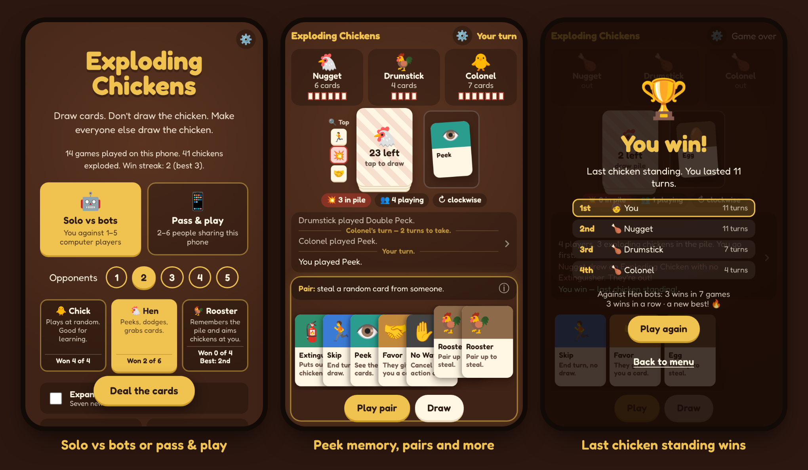

# Exploding Chickens

A card game of nerve for your phone. Draw cards, don't draw the chicken, make everyone else draw the chicken.



**Play:** https://pinardy.github.io/exploding-chickens/ — works offline, and installs to your home screen (Chrome: ⋮ → *Install app*; iPhone Safari: Share → *Add to Home Screen*).

## Features

- **Solo vs 1–5 bots** at three levels (Chick, Hen, Rooster), or **pass & play** for 2–6 people on one phone.
- **Variants:** expansion cards, quick game, hand limit.
- **Made for phones:** portrait and landscape, from iPhone SE up; tap to select, hold to read, double-tap or swipe up to play.
- **Helps you keep track:** remembers what you've peeked at, shows who played what, and keeps the full game log a tap away.
- **Saves as you go:** resume an unfinished game, plus win stats and streaks per difficulty.
- **Settings:** card size, bot speed, sound, vibration, reduced motion, left-handed layout.

## Cards

| Card | Effect |
|---|---|
| 💥 Exploding Chicken | Draw it without an Extinguisher and you're out |
| 🧯 Extinguisher | Puts out a chicken; you choose where it goes back in the pile |
| 🏃 Skip | End your turn without drawing |
| ⚡ Double Peck | End your turn; the next player takes 2 turns (stacks) |
| 🔀 Coop Shuffle | Shuffle the pile |
| 👁️ Peek | See the top 3 cards |
| 🤝 Favor | A player of your choice gives you a card of theirs |
| ✋ No Way | Cancel another player's action |
| 🔁 Reverse | End your turn without drawing and flip the turn order |
| 🐔 Hen, Rooster, Chick, Egg | Two of a kind steal a random card; three of a kind name the card you want |

**Expansion:** 🪂 Great Escape (skip every turn you owe), 🐛 Bottom Feeder (draw from the bottom), 🔍 Careful Peck (draw the first safe card), 🦊 Fox in the Henhouse (destroy someone's Favors and plain chickens), 🌪️ Coop Scramble (shuffle and redeal everyone's hands), 🌶️ Hot Chicken (toss a drawn chicken to the next player).

Reverse and the expansion mechanics are borrowed from [chickens.rakerman.com](https://chickens.rakerman.com); names, art and code here are original.

## Development

```bash
npm install
npm run dev      # local dev server
npm test         # engine fuzz test (700 random games) + unit tests
npm run build    # type-check and bundle to a single dist/index.html
```

Pushes to `main` deploy to GitHub Pages.

```
src/game/   the engine: plain TypeScript, no React, no timers
src/ui/     React screens, sheets, settings, saved game and stats
public/     PWA manifest, icons, service worker
```

The engine is pure (state in, new state out), and people and bots make choices through the same functions. That's what lets the fuzz test play hundreds of random games and check every step.
